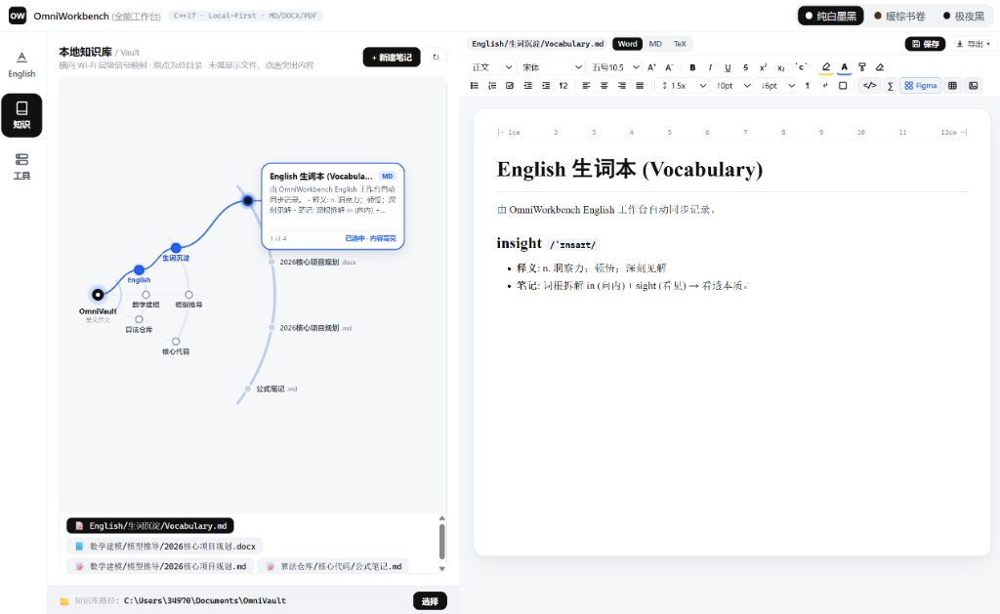
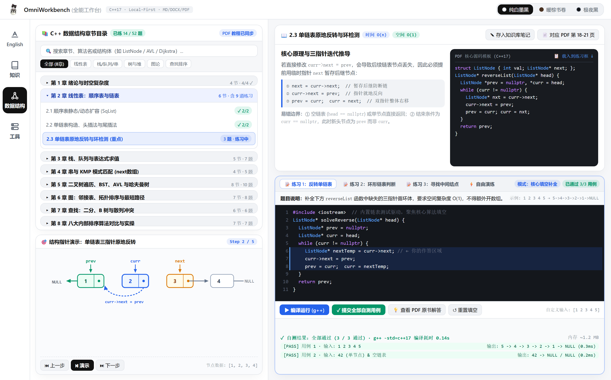

# OmniWorkbench (全能工作台)

基于 **C++17** 核心引擎 + **纯原生 Qt 6 (`QWidgets` + `QPainter` + `QSyntaxHighlighter` + `QTextDocument`)** 构建的本地优先（Local-First）无浏览器内核跨平台个人知识编辑、英语词汇与 C/C++ 数据结构学习桌面工作台，现已支持在 **Windows 桌面端** 与 **Linux (WSL2)** 运行。

## 下载与直接运行 (Windows Qt 6 便携免安装版)

- **完整免安装压缩包下载（推荐）**：[`releases/OmniWorkbench-win64.zip`](releases/OmniWorkbench-win64.zip)（约 `33 MB`，已打包全部 Qt 6 与 SQLite3 运行库及插件；下载解压后直接双击目录内的 **`OmniWorkbench.exe`** 即可启动！若需在「数据结构」页内本地编译运行练习题，电脑需安装 `g++` 并加入 `PATH`）
- **仅启动器备份**：[`releases/OmniWorkbench.exe`](releases/OmniWorkbench.exe)（依赖同目录或 `%LOCALAPPDATA%\OmniWorkbench\qt_app\` 中的运行库，普通用户请直接下载上方 `.zip` 完整包）

## 界面预览

### 1. 3D 魔方英语词库与长文真题工作台


### 2. 横向 Wi-Fi 知识库与 WPS 排版互通编辑器


### 3. C++ 数据结构与算法工作台（《算法笔记》Ch0–13 全课程 + 在线编译评测）


## 核心模块

### 1. 本地知识库与多格式转换 (`Markdown ↔ Word .docx ↔ PDF`)
- **纯 C++17 OpenXML (`.docx`) 引擎**：基于 `zlib` 自研 PKZIP 归档读写 (`src/core/zip_archive.cpp`) 与 XML DOM 解析 (`src/core/xml_doc.cpp`)，无须安装外部 Python/Pandoc 即可双向解析和生成标准 `.docx`。
  - 支持标题 (`Heading1`–`Heading4`)、粗体/斜体/删除线/行内代码、代码块、引用、有序/无序列表、Word 原生表格 (`<w:tbl>`)、超链接、双链 `[[...]]`，以及 **LaTeX ↔ Word 原生公式 (`<m:oMath>`)** 基础转译。
- **Word 多页 A4 仿纸张编辑 & 侧栏工具坞**：支持竖排停靠排版工具栏、`50%–180%` 滑块 / `Ctrl + 滚轮` 缩放、适宽大图 / 整页预览切换、分页符与实时页码跳转。
- **PDF 导出**：自动调用本机 Edge/Chromium 无头排版引擎生成高保真 A4 中文/公式 PDF，并内置纯 C++ PDF 1.4 兜底生成器。
- **四层波纹物理知识库**：使用 `std::filesystem` 扫描本地物理目录，支持 Windows 原生文件夹选择器 (`IFileOpenDialog`)、实时预览、右键菜单与 `Ctrl+S` 保存。

### 2. 交互式英语工作台 (`3D 魔方 + SQLite3 离线词库 + 生词本`)
- **3D 键盘序字母魔方 (`3×3×3`) & 二阶音标变形 (`2×2×2`)**：360° 拖拽旋转、分层拧动、音标速览与语音朗读。
- **SQLite3 离线词库 (`omni_dict.db`) & 三大开源词库一键导入**：
  - 兼容 [kajweb/dict](https://github.com/kajweb/dict)（JSON / NDJSON，自动提取四级/六级/考研/雅思/托福/专四/专八/SAT 词书标签、音标、短语与例句）
  - 兼容 [KyleBing/english-vocabulary](https://github.com/KyleBing/english-vocabulary)（JSON 数组格式）
  - 兼容 [skywind3000/ECDICT](https://github.com/skywind3000/ECDICT)（`ecdict.csv` 流式批量导入）
- **生词沉淀**：方块标记、重点收藏与学习笔记持久化保存至 SQLite3，并一键追加写入本地知识库的 `English/生词沉淀/Vocabulary.md`。

### 3. C/C++ 数据结构与算法工作台 (`SQLite3 课程库 + g++ 实时自测`)
- **全书结构化入库**：基于《算法笔记》（Ch 1–13）与集训前导课程覆盖 **14 章 · 72 节彩色网页教程 · 76 道随堂练习题**，从纯 C 基础语法/指针/结构体 (`Ch0–5`) 循序渐进到 C++ STL (`Ch6`) 与高阶数据结构/图论/动态规划/树状数组/线段树 (`Ch7–13`)。
- **交互式原生绘图与在线评测**：内置 `QPainter` 高清交互动画与 `QSyntaxHighlighter` 代码高亮，底部独立练习框支持原生行号同步对齐、标准输入运行与后台线程实时评测 (`Ctrl+Enter`)，做题进度与笔记持久保存至 `omni_ds_course.db`。

### 4. 工具诊断与文档格式互转中心
- 实时展示当前 Qt 6 原生界面环境、本地 `g++` 编译器、数据目录与 PDF 引擎状态，并提供离线 `Markdown ↔ Word .docx ↔ A4 PDF` 一键文件转换器。

---

## 构建与运行

```bash
# Linux (WSL2) 编译并运行全部 C++ 单元测试
make all

# 启动 Linux 本地服务
./build/linux/omniworkbench

# 命令行直接转换文档格式
./build/linux/omniworkbench --convert input.md --to docx -o output.docx
./build/linux/omniworkbench --convert input.docx --to md -o output.md
./build/linux/omniworkbench --convert input.md --to pdf -o output.pdf

# 交叉编译静态独立的 Windows 桌面可执行文件并运行 Windows 端测试
make windows
# 产物位置：build/win/OmniWorkbench.exe
```

### 纯原生 Qt 6 CMake 构建
若系统已安装 Qt 6 (`Qt6::Widgets`，无需 `WebEngineWidgets`) 与 CMake：
```bash
cmake -B build-qt -DENABLE_QT6=ON
cmake --build build-qt
```
